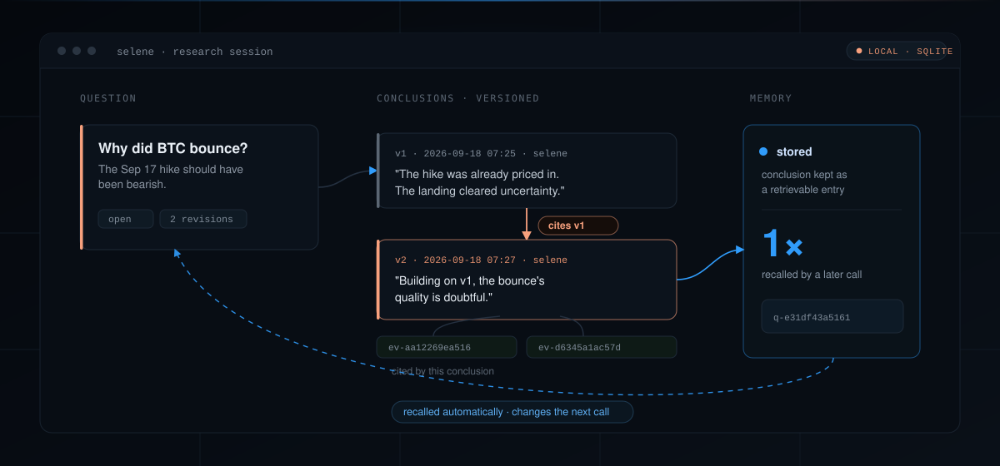

<div align="center">
  

  <h3>本地优先的 AI 量化研究组织。问题是持久的，结论是版本化的，过去会改变下一次判断。</h3>

  <p>大多数研究工具保存答案。SeleneQuant 保存<em>问题</em>，对它跑真实实验，给每条结论编版本，并在下一个问题到来时自动取回已经确立的东西。跑这个回路的，是一个 AI 研究组织；回路之下是一套完整量化栈；再配上让你知道结果是不是真的那套统计。</p>

  <p>
    <a href="#四个物种"></a>
    <a href="#回路跑在一套真实的量化栈上"></a>
    <a href="#今天真正能跑的东西"></a>
  </p>

  <p>
    <a href="https://github.com/papisoV/selenequant/actions/workflows/ci.yml"></a>
    <a href="LICENSE"></a>
    
    
  </p>

  <p><a href="README.md">English</a> · <a href="README.zh-CN.md">中文</a></p>
</div>



---

> **仓库姿态。** 本公开仓库以一系列经过校验的快照，跟踪一个内部开发的项目，而非其完整历史。因此 PR 在这里没有可合并的分支 —— 这是机制上的限制，不是闭门。欢迎并会阅读 issue；你的改动也可以被吸收进未来的快照并署名（见 [CONTRIBUTING](.github/CONTRIBUTING.md)）。

## 四个物种

这个领域的产品看起来都差不多，直到你问：它们各自拿「时间」怎么办。四个物种并排放着，读完你应该能看出它们不是同一种东西：

| 物种 | 它对你说的话 |
|---|---|
| 交易 / 量化软件 | 我提供工具，你操作。 |
| AI 金融聊天机器人 | 你提问，我回答。 |
| AI 量化 agent | 你给任务，我执行。 |
| **SeleneQuant** | **你交出一个问题；它持续研究。现实交回结果；它把结果带进下一次判断。** |

分界不在于有没有记忆。现代工具都有上下文、文件或记忆；Obsidian 加 Git 也存得起结构化历史。分界是：存下的历史会被**自动取回，并改变下一次判断**。只存不取，是研究档案；存而能取，才是研究组织。

对着聊天物种，同一条分界是这样：

| | 普通 AI 助手 | SeleneQuant |
|---|---|---|
| 单位 | 一次对话 | 一个持久问题 |
| 历史 | 每个问题彼此独立 | 每条结论带着问题的全部历史 |
| 输出 | 一段回答文本 | 版本化结论 + 它引用了什么 |
| 结果 | 回答完就结束 | 现实结果回流，改变下一版判断 |

## 快速开始

要求：**Python 3.11+**、**Node 20+**。Windows / macOS / Linux 均可。

```bash
git clone https://github.com/papisoV/selenequant
cd selenequant
pip install -r requirements.txt

# 推荐：启动后端与前端，等健康检查通过，打印访问地址
python dev.py --prod
```

`python dev.py --prod` 会设置工作区 `PYTHONPATH`、拉起 API，若前端构建过期则先构建一次，然后提供服务。当它打印出地址：

- 后端 API 与文档：`http://127.0.0.1:8088/docs`
- 前端应用：`http://localhost:3000`

**跑起来用 `--prod`，改前端时去掉它。** 不带 `--prod`（`python dev.py`）时，Next.js 会在你**首次打开每个页面时现编译** — 本仓库有约 142 个路由，这就是新开会话感觉卡的原因。`--prod` 只构建一次（构建保持新鲜时自动跳过），之后直接提供预编译页面。

浏览器请用 **`localhost`** 访问，不要用 `127.0.0.1`。Next.js 的开发期跨源保护会拒绝裸 IP，页面会一直卡在 "Connecting to runtime"。

Windows 上也可以直接双击 `dev.bat`（同一件事的批处理版）。两者都不需要额外配置；只有当你确实要走代理时，才需要自己设 `SELENE_PROXY_URL`。

<details>
<summary>手动双终端启动</summary>

```bash
# 终端 1：后端
call activate.bat
cd services/local-api
uvicorn app.main:app --host 127.0.0.1 --port 8088

# 终端 2：前端
cd apps/desktop
npm install
npm run dev
```

</details>

> **不要跑 `pip install -e .`。** 它会把一个绝对路径写进全局 `site-packages`，指向你安装时的那个副本。在多副本环境下会静默加载错误的源码。请用 `pip install -r requirements.txt`，让 `activate.bat` 注入 `PYTHONPATH`。

## 它做什么

在 SeleneQuant 里，一个问题是一个活的对象。你把它开出来，Selene 对它做研究（实验、证据、结论），每个结论是一个编号的**版本（revision）**。新版本可以引用上一版以及支撑它的证据。没有任何东西被覆盖，也没有任何东西假装自己知道得比当时多。

下面是一条真实研究线（逐字取自作者的研究库）：

> **问：BTC 为什么最近反弹了？9 月 17 日宣布加息，不应该利空吗？**
>
> **v1** · 无引用 · *利空已提前定价，加息落地等于不确定性出清。* BTC 在 9/15-16 已先跌到 $75.6K 月内低点，9/16 ETF 单日流出 $4.5 亿（6 月以来最大）；决议前市场已按约 93% 概率定价 25bp 加息。9/17 加息落地反而触发反弹至 $77K。
>
> **v2** · **引用 v1** · *在第一版基础上，反弹成色存疑。* 需求端三条腿都弱：Coinbase 溢价打到月内新低、企业金库 3 个月仅买入约 5900 BTC、ETH/XRP ETF 转为净流出。若「加息后反弹 = 出清」成立，后续应有现货持续净流入确认；若 BTC 跌回 $75K 下方且溢价不修复，则第一版的出清论是错的。

再看一条更深的线：一个问题，四次实验，其中一次推翻了上一次的判决。

| # | 实验 | 判决 | 关键数 |
|---|---|---|---|
| 1 | funding 因子族 4-bar IC sweep | NO-GO | 全族 \|IC\| ≤ 0.02 |
| 2 | funding 多日视界 IC sweep | **翻案** | 7d 全 symbol 过 0.10 线 |
| 3 | funding 入场否决实验 门1 | veto 不成立 | 3243 笔 tagged 交易，胜率全档平坦 |
| 4 | funding carry+反转模拟 门2 | INCONCLUSIVE | ETH+SOL 池化 n=203，CI95 跨零 |

最终那一条结论，按 id 逐条引用了全部四次实验。

## 架构

整个产品就是一个回路。一个问题持续存在；研究产生证据和编号版本；每个版本可以引用此前的版本及其证据；存下的结论会被自动取回，于是下一次判断从已经确立的东西出发，而不是从零开始。


## 回路跑在一套真实的量化栈上

回路是产品。回路之下，是一个经年累月真实使用堆出来的平台，而且大部分是能跑的代码，不是路线图：


### AI 研究组织

大多数「AI 量化」产品是单个 agent 在聊天窗口里回答问题。Selene 按研究机构的方式组织：有评审会在评审，有日循环在排程，有投委会在决策前审议。一个模型单独回答是演示；一个从独立视角评审证据的组织，才是让你保持诚实的东西。

- **三视角评审会**：经验派（只认被证据锚住的历史）、记录派（只看未验证的线索）、挑战派（对抗角色）在严格的召回类别隔离下各自独立召回历史，然后由主持人写下下一版。挑战派的存在是为了杀掉你最喜欢的假设，不是为了附和你。
- **五阶段日循环**：盘前、风险评审、投委会决策、执行、盘后；投委会决策可由带显式审议的人设委员会驱动
- **Agent 运行时**：ReAct 循环 + 30+ 工具（行情、策略、模拟盘、网格、风控、沙箱）、MCP 客户端、上下文预算与压缩、五种记忆（决策结果、偏好、研究记忆、策略失败、交易记忆）
- **研究循环与人设库**：专用多智能体循环（因子、模型、量化、报告），以及从量化研究员到组合经理的 Renaissance 风格人设库
- **本地模型欢迎**：适配层支持任意 OpenAI 兼容端点 + Ollama，带优先级链路由与健康探针

### 对抗过拟合的统计

回测是个很容易被骗的东西。测二十组参数，总有一组纯靠运气看起来很美；大多数开源回测框架直接把 Sharpe 递给你，让你自己去发现这一点。这套套件自带的是那台告诉你「这个数大概率是运气」的机器：

- **Deflated Sharpe ratio** 与概率 Sharpe，含期望最大 Sharpe 与最短 Track Record 长度
- **回测过拟合概率（PBO）**，经组合对称交叉验证（CSCV）
- **Purged K-fold 交叉验证**，处理重叠样本
- **蒙特卡洛**：bootstrap 收益分布、参数敏感性扫描、权益曲线分布
- **Walk-forward 验证**：5 折、70/30 训练切分、每折 20 次 Optuna 试验，报告 IS/OOS 比值
- LLM 调参器暴露 8 个优化目标、把不达标者踢出排名的样本外 70/30 硬门、多种子方差、`--min-trades` 过滤

研究脚本遵循同一纪律：预登记假设、GO/NO-GO 判决前的 bootstrap 置信区间（2,000 次重采样），以及在一组冻结 fixture 上逐位对齐、验证网格引擎移植正确性的 bit-for-bit 对等 harness。

### 策略实验室

模板本身是大路货；这里的关键是一个策略是有生命周期的工件，不是 notebook 里的一个单元格：一份 YAML 定义、带版本、可回测、从回测到模拟盘到实盘一路晋升而无需重写。

| | |
|---|---|
| **49 个内置模板** | 趋势、动量、均值回归、突破、网格、定投、日历效应、波动率门控、成本门控；全部参数化、可直接回测 |
| **26 个独立 YAML 策略** | 包括 ICT 结构（公平价值缺口、订单块、流动性扫荡）、资金费率套利、BTC/ETH 配对、多周期趋势 |
| **29 个内置指标** | 从 SMA/RSI/MACD 到 Hurst 指数、半衰期、市场结构识别 |
| **组合层** | 多周期共振、带推荐器的融合集成、做市库存模型、不受信任策略代码的受限执行沙箱 |
| **一个文件，三个运行时** | 同一份 YAML 同时驱动回测、模拟盘、实盘 |

### 真实成本的回测引擎

把成本建模成零的回测，是一台专门生产虚假信心的机器。这台引擎照实收钱：事件驱动执行，滑点模型族刻画现实而不是把现实假设掉（固定、买卖价差、复合、**成交量感知**，以及将三者组合的现实模型）；永续仓位逐 bar 注入真实历史资金费率，让 funding 真实打进 PnL。多资产组合分配与模拟盘基准内置。

### 因子与 alpha 挖矿

一条无法复现的公式只是道听途说。挖矿栈把公式当作携带自身词表摘要的序列化工件，你挖出来的东西能对着它挖矿时的词表完成校验：

- **公式虚拟机**：133 token 词表（110 特征 + 23 算子）跑在栈式执行器上，词表摘要确定性可复现，序列化的公式工件能对着它挖矿时的词表完成校验
- **强化学习挖矿**：PyTorch 公式策略网络，含一个适应度直接取回测 Sharpe 的 REINFORCE 变体
- **种子化搜索**：Alpha101 公式翻译成词表 token 作 warm-start 种群，另有遗传搜索与孤岛模型引擎
- **因子卫生**：去极值/标准化/中性化管线、泄漏检查、前视对齐、成本模型、权重漂移回测
- **Serenity 评分**：8 因子 + 8 惩罚的加密风险模型，支持消融
- **EventGuard 事件护栏**：宏观事件前后给策略降风险的刹车层，由四个事件源供数（宏观日历、信用、Telegram 信号、VIX）

### 市场与数据

研究只能看到引擎能读到的东西；引擎读不到的市场，是挂着价格标签的盲区。这里的广度服务于研究问题，不是打勾清单：

- **7 家交易所与经纪商**：Binance（现货 + 期货，含 L2 订单簿管理）、OKX、Alpaca（美股）、Deribit（期权）、Polymarket（预测市场）、QMT（国内券商）、Solana（Jupiter 聚合器）；另有 3 家 DEX 永续
- **加密之外的 4 类资产**：美股、A 股、台股、国内期货/外汇
- **订单流**：13 个聚合器（CVD、印记、热图、VPVR、大单与爆仓地图、合并盘口），跑在带回放的 tick 存储上
- **衍生品数据**：资金费率、持仓量、期权链、爆仓热图、链上抓取
- **摄取线**：新闻（RSS 采集、LLM 打标、对着期货 1m K线做成交量异动回验）、Telegram 信号抽取、基金数据（可转债、LOF/ETF 溢价、REITs）、6 个宏观 provider（FRED、BIS、BLS、两个恐贪指数、CoinGecko）
- **A 股研究**：16 个因子函数 + IC/IR 评估、Point-in-Time 财报（按公告日生效，无前视）、涨停情绪广度、7 个选股策略模板（海龟、RPS 突破、高位紧旗形等）、参数敏感性实验室

### 风险与执行安全

实盘通路是未经验证的假设变成亏损的地方，所以任何东西都不靠信念到达那里：

- **30+ 条风控规则**：仓位与敞口限制、日亏损熔断、回撤断路器、相关性与拥挤度检查、流动性过滤、**貔貅盘检测**、Kelly 与波动率缩放的仓位计算
- **VaR 套件**：历史法、参数法、蒙特卡洛、CVaR
- **执行层**：算法单（VWAP、POV、自适应）、括号单、切片器、影子执行引擎、append-only 订单日志、启动对账、断线分诊、kill switch
- **验证过的，不是假设的**：24 小时影子档演练，7 条验收判据（日志完整性、影子-模拟权益偏差 <5%、kill switch 取证、重启恢复）把守实盘通路

## 今天真正能跑的东西

一张诚实的地图，因为一个你无法审计的研究工具没有价值。

**今天能端到端跑通：**开一个问题 → 跑实验 → 写一条引用其证据的结论 → 把这条结论存到后续问题能找到的地方。策略模板、带真实成本的回测、反过拟合统计、带样本外硬门的调参器、因子与 alpha 挖矿、模拟盘、风控规则、网格引擎、数据同步管线，全部是作者日常使用的真实代码。

**刻意保留在早期：**两块。决策到结果的回路目前只记录了很少的判决，且尚未在 UI 里处处可见；对历史结论的自动召回目前接了一部分路径、不是全部。两块都在补，都没有藏起来。

## 定义并运行一个策略

一个策略就是一个 YAML 文件。同一个文件同时驱动回测、模拟盘和实盘。

```yaml
# demo/strategies/rsi_reversal.yaml
id: template-rsi-reversal
name: RSI Reversal
type: rsi_reversal
symbols: [BTC/USDT]
interval: 1h
parameters:
  rsi_period: 14
  oversold: 30
  overbought: 70
entry_rules:
  long:
    - indicator: rsi
      params: { period: 14 }
      operator: less_than
      comparator: 30.0
exit_rules:
  close_long:
    - indicator: rsi
      params: { period: 14 }
      operator: greater_than
      comparator: 70.0
risk_params:
  stop_loss_pct: 0.02
  take_profit_pct: 0.05
  max_open_positions: 1
```

从终端运行：

```bash
call activate.bat
python scripts/generate_demo_data.py     # 写出 demo/data/*.parquet（拉真实 1h K 线，无网时退化为合成数据）
selenespace backtest run demo/strategies/rsi_reversal.yaml --data demo/data/btc_usdt_1h_90d.parquet
```

```
Backtest complete
  Total return: 12.09%
  Sharpe: 0.6234
  Max DD: -3.92%
  Trades executed: 13
```

> `generate_demo_data.py` 不需要 API key：它拉取 Binance 公开 1h K 线，网络不可用时
> 写出确定性的合成数据。产物落在已被 git 忽略的 `demo/data/` 下。

或用 Python，对着实时行情跑：

```python
from selene_space_strategy.compiler import compile
from selene_space_strategy.models import load_strategy
from selene_space_strategy.runtime import StrategyRuntime
from selene_space_backtest.engine import BacktestConfig, BacktestEngine
from selene_space_market.sources.binance_source import BinanceSource

config = load_strategy("demo/strategies/rsi_reversal.yaml")
runtime = StrategyRuntime(compile(config))

source = BinanceSource(market_type="spot")
await source.start()
klines = await source.fetch_klines_rest(symbol="BTC/USDT", interval="1h", limit=500)
await source.stop()

engine = BacktestEngine(config=BacktestConfig(
    initial_cash=10_000.0, strategy_id=config.id,
    symbol=config.symbols[0], interval=config.interval,
))
result = engine.run(strategy=runtime, data=klines)
print(result.metrics.sharpe_ratio, result.trades_count)
```

完整可运行版本见 [`examples/backtest_demo.py`](examples/backtest_demo.py)。

## 终端与 CLI

执行 `call activate.bat` 后，`selenespace` 命令即可用。CLI 与桌面应用在进程内跑同一套引擎库，两个表面背后没有第二套实现。

```bash
selenespace setup                       # 六阶段首次运行向导；交易所密钥进 OS 钥匙串
selenespace status                      # 一眼看清环境
selenespace doctor                      # 19 项诊断（--repair 可自动修复）
selenespace market ticker BTC/USDT      # 读行情
selenespace backtest run <strategy.yaml> --data <parquet>
selenespace paper create --help         # 模拟盘账本
selenespace ashare report 600519        # A 股因子报告：IC、分位、正交化
selenespace ask "BTC 4h 过去30天的波动率怎么样?"
```

## API 与 Web 应用

后端在 79 个路由模块里暴露 **523 个端点**（另有 8 条 WebSocket 实时流：行情、模拟盘、agent 对话、研究），Next.js 应用有 **142 个页面**，分四个场景（盯盘、研策、执行、系统）。

| API 区域 | 端点数 | 那里放着什么 |
|---|---|---|
| 研究图谱 + 任务 | 42 | 问题、版本、证据、召回、完整性审计、归因 |
| Alpha 与因子挖矿 | 37 | 公式生命周期、验证、工件 |
| 策略工厂 | 25 | 模板、版本、部署、导出 |
| 预测市场 | 22 | Polymarket 扫描与告警 |
| 实盘交易 | 21 | 订单、持仓、kill switch、延迟统计 |
| 模拟盘 | 16 | 账户、订单、成交、PnL |
| 优化 | 16 | 自动与手动优化 run |
| 网格引擎 | 12 | 网格策略、哨兵、状态 |
| AI agent | 11 | 对话、团队、流式分析、推理轨迹 |
| 其余 | ~310 | 行情、衍生品、新闻、宏观、告警、记忆、影子档等 |

## 里面有什么

本地优先的 monorepo。Python 包在 `packages/`，FastAPI 服务在 `services/local-api/`，Next.js 应用在 `apps/desktop/`。

| 领域 | 位置 | 那里有什么 |
|---|---|---|
| 策略引擎 | `packages/strategy-engine/` | 49 模板、26 YAML 策略、29 指标、编译器、优化器、多周期共振、融合集成、受限沙箱 |
| 回测引擎 | `packages/backtest-engine/` | 事件驱动回测、6 种滑点模型、资金费率注入、多资产组合、DSR / PBO / purged K-fold、蒙特卡洛 |
| 交易所 SDK | `packages/exchange-sdk/` | 7 交易所 + 3 DEX、算法单、影子引擎、订单日志、启动对账 |
| 行情数据 | `packages/market-data/` | 6 数据源、可回放 tick 存储、衍生品抓取、13 个订单流聚合器、市场状态引擎 |
| 因子研究 | `packages/factor-research/` | 预处理管线、遗传搜索、泄漏检查、成本模型 |
| Alpha 核心 | `packages/alpha-core/` | 公式 VM（133 token）、RL 挖矿、Serenity 评分、EventGuard、组合构建 |
| 风控引擎 | `packages/risk-engine/` | 30+ 规则、貔貅盘检测、VaR 套件、kill switch |
| 模拟盘引擎 | `packages/paper-engine/` | 账户、订单、成交、PnL、审计账本、分层移动止损 |
| 网格引擎 | `packages/grid-engine/` | 中性双腿网格、对等验证移植、闸门校准 |
| Agent 运行时 | `packages/agent-runtime/` | ReAct 循环、30+ 工具、MCP 客户端、技能、5 种记忆 |
| 多智能体层 | `packages/agentstudio/`, `packages/renintel/`, `packages/daily-cycle/` | 研究循环、带投委会审议的人设库、五阶段日循环 |
| 摄取 | `packages/news-ingest/`, `packages/tg-ingest/`, `packages/fund-ingest/`, `packages/macrodata/` | 新闻管线、Telegram 信号、基金数据、6 个宏观 provider |
| 多市场 | `packages/ashare/`, `packages/ashare-select/`, `packages/stock/`, `packages/commodities-fx/` | A 股因子与选股、美股评分、台股连接器、期货与外汇 |
| LLM 适配 | `packages/llm-adapter/` | OpenAI 兼容 + Ollama，优先级链路由 |
| Web 应用 | `apps/desktop/` | Next.js，142 页面，4 场景 |
| 后端 | `services/local-api/` | FastAPI，523 端点，8 条 WebSocket 流 |
| CLI | `packages/cli/` | 8 命令组、19 项诊断 |
| 根目录启动器 | `activate.bat`、`dev.bat`、`dev-reload.bat`、`prod.bat`、`run.bat` | Windows 入口：`activate.bat` 为当前副本设置 `PYTHONPATH`（跑裸 `python` 前先执行它），`dev.bat` 一键启动全部，`run.bat` 在已激活环境里跑脚本。见上方「快速开始」。 |

## 文档

- [`docs/PRODUCT.md`](docs/PRODUCT.md)：SeleneQuant 是什么、不是什么
- [`docs/DESIGN.md`](docs/DESIGN.md)：设计正典
- [`.github/CONTRIBUTING.md`](.github/CONTRIBUTING.md)：如何报 issue 与本地运行
- [`ATTRIBUTIONS.md`](ATTRIBUTIONS.md)：vendored 与引用的项目

## 许可

AGPL-3.0-only，见 [`LICENSE`](LICENSE)。

## 无复制声明

`packages/market-analysis` 两阶段行情分析工作流为本项目独立重实现：

- 工作流概念由本项目自有 `packages/decision-workflow` 与公开文献（Al Brooks 价格行为出版物等）独立推导；
- 所有代码与 prompt 文本为独立撰写；
- 与同领域独立项目无复制关系，未读取其 prompt 文本；
- 不构成任何外部作品的衍生作品。

详见 [`ATTRIBUTIONS.md`](ATTRIBUTIONS.md) 与 [`packages/factor-research/THIRD_PARTY_NOTICES.md`](packages/factor-research/THIRD_PARTY_NOTICES.md)。
