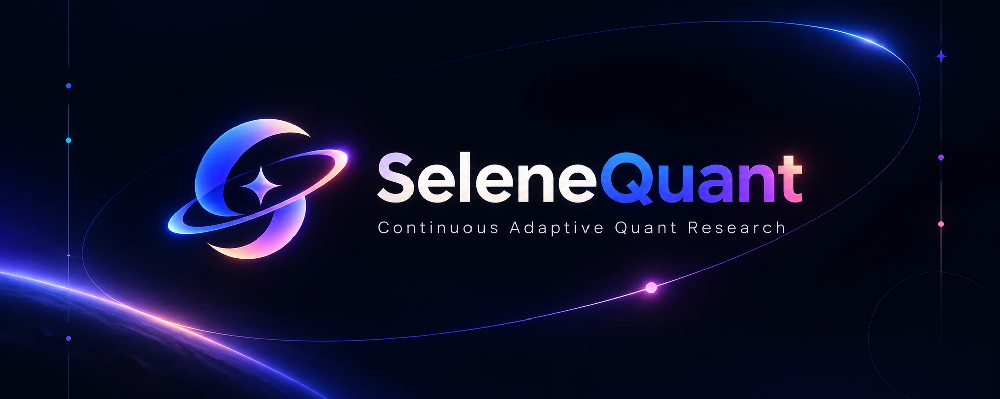
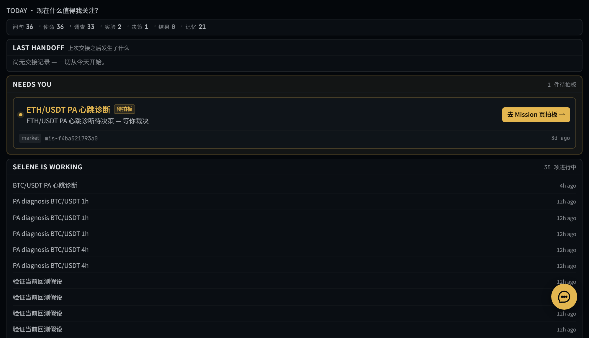
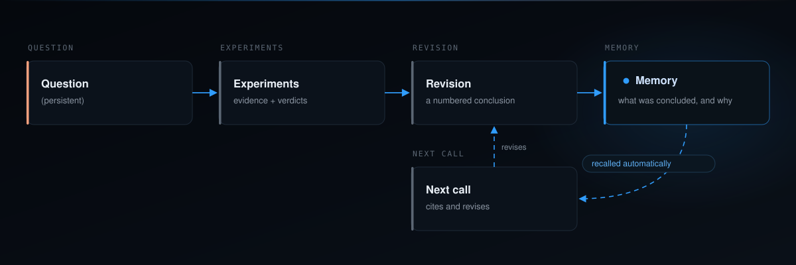
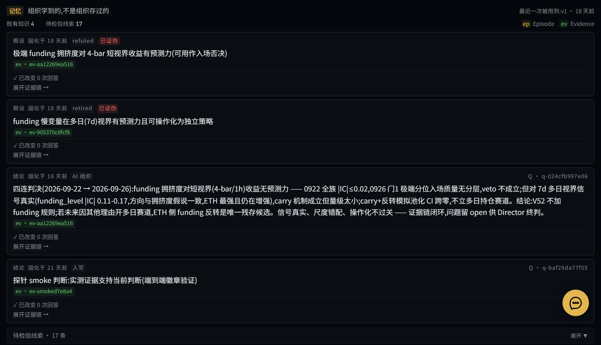
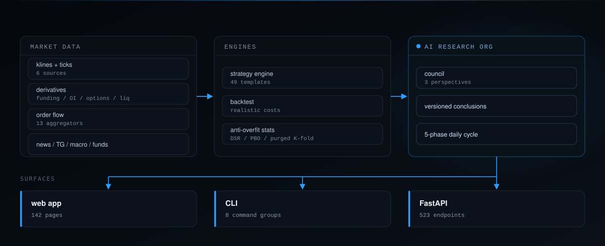

<div align="center">
  

  <h3>本地优先的 AI 量化研究组织。问题是持久的，结论是版本化的，过去会改变下一次判断。</h3>

  <p>大多数研究工具保存答案。SeleneQuant 保存<em>问题</em>，对它跑真实实验，给每条结论编版本，并在下一个问题到来时自动取回已经确立的东西 —— 回路之下是一套完整的量化栈，再配上让你知道结果是不是真的那套统计。</p>

  <p>
    <a href="#快速开始"></a>
    <a href="#底下的平台"></a>
    <a href="#今天真正能跑的东西"></a>
  </p>

  <p>
    <a href="https://github.com/papisoV/selenequant/actions/workflows/ci.yml"></a>
    <a href="LICENSE"></a>
    
    
  </p>

  <p><a href="README.md">English</a> · <a href="README.zh-CN.md">中文</a></p>

  <p>
    <a href="https://x.com/Kairos_Selene"></a>
    <a href="https://space.bilibili.com/110740322"></a>
  </p>

  

  <sub>一个正在运行的实例，不是效果图：五阶段循环的实时计数、一次交接、一件等待人工拍板的事项，以及 35 项进行中。</sub>
</div>

---

> **仓库姿态。** 本公开仓库以一系列经过校验的快照跟踪一个内部开发的项目，而非其完整历史。因此 PR 在这里没有可合并的分支 —— 这是机制上的限制，不是闭门。欢迎并会阅读 issue；你的改动也可以被吸收进未来的快照并署名（见 [CONTRIBUTING](.github/CONTRIBUTING.md)）。

## 快速开始

要求 **Python 3.11+**、**Node 20+**；Windows / macOS / Linux 均可。

```bash
git clone https://github.com/papisoV/selenequant
cd selenequant
pip install -r requirements.txt

# 前端有自己的依赖；ci 严格按 package-lock 装，可复现
cd apps/desktop && npm ci && cd ../..

# 启动后端与前端，等健康检查通过
python dev.py --prod
```

它会打印两个地址：后端 API 与文档在 `http://127.0.0.1:8088/api/v1/docs`，前端应用在 `http://localhost:3000`。首次启动会创建一个空的本地数据库并在后台同步行情，所以刚打开时你看到的是界面框架加上已同步进来的那部分，不是装坏了。

**跑起来用 `--prod`，改前端时去掉它。** 不带 `--prod` 时 Next.js 会在首次打开每个页面时现编译，约 145 个路由下来就是新开会话感觉卡的原因；`--prod` 只构建一次，之后直接提供预编译页面。

浏览器请用 **`localhost`** 访问，不要用 `127.0.0.1` —— Next.js 的开发期跨源保护会拒绝裸 IP，页面会一直卡在 "Connecting to runtime"。Windows 上 `dev.bat` 是同一件事的批处理版；只有确实要走代理时才需要设 `SELENE_PROXY_URL`。

<details>
<summary>手动双终端启动</summary>

```bash
# 终端 1：后端
call activate.bat
cd services/local-api
uvicorn app.main:app --host 127.0.0.1 --port 8088

# 终端 2：前端
cd apps/desktop
npm install
npm run dev
```

</details>

> **不要跑 `pip install -e .`。** 它会把一个绝对路径写进全局 `site-packages`，指向你安装时的那个副本，在多副本环境下会静默加载错误的源码。请用 `pip install -r requirements.txt`，让 `activate.bat` 注入 `PYTHONPATH`。

## 它做什么

一个问题是一个活的对象。你把它开出来，Selene 对它做研究 —— 实验、证据、结论 —— 每个结论是一个编号的**版本（revision）**，可以引用上一版以及支撑它的证据。没有任何东西被覆盖，也没有任何东西假装自己知道得比当时多。

下面是一条真实研究线（逐字取自作者的研究库）：

> **问：BTC 为什么最近反弹了？9 月 17 日宣布加息，不应该利空吗？**
>
> **v1** · 无引用 · *利空已提前定价，加息落地等于不确定性出清。* BTC 在 9/15-16 已先跌到 $75.6K 月内低点，9/16 ETF 单日流出 $4.5 亿（6 月以来最大）；决议前市场已按约 93% 概率定价 25bp 加息。9/17 加息落地反而触发反弹至 $77K。
>
> **v2** · **引用 v1** · *在第一版基础上，反弹成色存疑。* 需求端三条腿都弱：Coinbase 溢价打到月内新低、企业金库 3 个月仅买入约 5900 BTC、ETH/XRP ETF 转为净流出。若「加息后反弹 = 出清」成立，后续应有现货持续净流入确认；若 BTC 跌回 $75K 下方且溢价不修复，则第一版的出清论是错的。

一个问题，四次实验，其中一次推翻了上一次的判决：

| # | 实验 | 判决 | 关键数 |
|---|---|---|---|
| 1 | funding 因子族 4-bar IC sweep | NO-GO | 全族 \|IC\| ≤ 0.02 |
| 2 | funding 多日视界 IC sweep | **翻案** | 7d 全 symbol 过 0.10 线 |
| 3 | funding 入场否决实验 门1 | veto 不成立 | 3243 笔 tagged 交易，胜率全档平坦 |
| 4 | funding carry+反转模拟 门2 | INCONCLUSIVE | ETH+SOL 池化 n=203，CI95 跨零 |

最终那一条结论，按 id 逐条引用了全部四次实验。

## 回路

一个问题持续存在；研究产生证据和编号版本；每个版本可以引用此前的版本及其证据；存下的结论会被自动取回，于是下一次判断从已经确立的东西出发，而不是从零开始。





## 底下的平台

回路是产品。回路之下，是一个经年累月真实使用堆出来的平台，而且大部分是能跑的代码，不是路线图。



**是研究组织，不是聊天窗口。** 三个召回视角 —— 经验派（只认被证据锚住的历史）、记录派（只看未验证的线索）、对抗性的挑战派 —— 在严格的类别隔离下各自独立读过历史，才由主持人写下下一版。五阶段日循环（盘前、风险评审、投委会决策、执行、盘后）负责排程，其中投委会决策可由带显式审议的人设委员会驱动。再往下是 ReAct agent 运行时：30+ 工具、MCP 客户端、上下文预算与压缩、五种记忆。

**对抗过拟合的统计。** 回测很容易被骗：测二十组参数，总有一组纯靠运气赢。这套套件自带的就是那台告诉你「这个数大概率是运气」的机器 —— deflated Sharpe（含期望最大 Sharpe 与最短 Track Record 长度）、经 CSCV 的回测过拟合概率、处理重叠样本的 purged K-fold，以及每次回测默认运行的蒙特卡洛重采样（交易顺序置换、自助法 Sharpe 区间、权益分位带）。Walk-forward 跑 5 折、70/30 切分、每折 20 次 Optuna 试验，调参器暴露 8 个目标并带样本外硬门。

**策略是工件，不是 notebook 单元格。** 49 个内置模板 + 28 套独立 YAML 策略（含 ICT 结构、资金费率套利、配对），一份文件同时驱动回测、模拟盘与实盘而无需重写；另有 29 个内置指标、多周期共振、融合集成，以及运行不可信策略代码的受限沙箱。

**成本是收的，不是假设掉的。** 事件驱动执行，六种滑点模型（固定、价差、复合、成交量感知及其组合），永续仓位逐 bar 注入真实历史资金费率，并内置多资产组合分配。

**公式能复现。** 133 token 词表（110 特征 + 23 算子）上的公式虚拟机，词表摘要是确定性的，序列化工件能对着它挖矿时的词表完成校验 —— 外加 RL 挖矿、Alpha101 种子、遗传与孤岛模型搜索、泄漏检查，以及由宏观日历、信用、Telegram 信号、VIX 供数的 EventGuard 刹车层。

**广度服务于问题。** 7 家交易所与经纪商 + 3 家 DEX 场所，加密之外 4 类资产，13 个订单流聚合器跑在可回放的 tick 存储上，以及按公告日生效、无法前视的 A 股 Point-in-Time 财报研究。

**没有任何东西靠信念到达实盘。** 30+ 条风控规则（含貔貅盘检测）、VaR/CVaR 套件、带影子引擎与 append-only 订单日志的执行层，以及一套必须全部通过才能打开实盘通路的 24 小时影子档演练 —— 7 条验收判据。

## 今天真正能跑的东西

一张诚实的地图，因为一个你无法审计的研究工具没有价值。

**今天能端到端跑通：** 开一个问题 → 跑实验 → 写一条引用其证据的结论 → 把这条结论存到后续问题能找到的地方。策略模板、带真实成本的回测、反过拟合统计、带样本外硬门的调参器、因子与 alpha 挖矿、模拟盘、风控规则、网格引擎、数据同步管线，全部是作者日常使用的真实代码。

**刻意保留在早期：** 两块。决策到结果的回路目前只记录了很少的判决，且尚未在 UI 里处处可见；对历史结论的自动召回接了一部分路径、不是全部。两块都在补，都没有藏起来。

## 定义并运行一个策略

一个策略就是一个 YAML 文件，同一个文件同时驱动回测、模拟盘和实盘。

```yaml
# demo/strategies/rsi_reversal.yaml
id: template-rsi-reversal
name: RSI Reversal
type: rsi_reversal
symbols: [BTC/USDT]
interval: 1h
parameters:
  rsi_period: 14
  oversold: 30
  overbought: 70
entry_rules:
  long:
    - indicator: rsi
      params: { period: 14 }
      operator: less_than
      comparator: 30.0
exit_rules:
  close_long:
    - indicator: rsi
      params: { period: 14 }
      operator: greater_than
      comparator: 70.0
risk_params:
  stop_loss_pct: 0.02
  take_profit_pct: 0.05
  max_open_positions: 1
```

```bash
call activate.bat
python scripts/generate_demo_data.py     # 写出 demo/data/*.parquet（拉真实 1h K 线，无网时退化为合成数据）
selenespace backtest run demo/strategies/rsi_reversal.yaml --data demo/data/btc_usdt_1h_90d.parquet
```

`generate_demo_data.py` 不需要 API key：它拉取 Binance 公开 1h K 线，网络不可用时写出确定性的合成数据。想从 Python 直接驱动引擎，见 [`examples/backtest_demo.py`](examples/backtest_demo.py)。

## 终端

执行 `call activate.bat` 后，`selenespace` 命令即可用。CLI 与桌面应用在进程内跑同一套引擎库，两个表面背后没有第二套实现。

```bash
selenespace setup                       # 六阶段首次运行向导；交易所密钥进 OS 钥匙串
selenespace doctor                      # 19 项诊断（--repair 可自动修复）
selenespace market ticker BTC/USDT      # 读行情
selenespace backtest run <strategy.yaml> --data <parquet>
selenespace paper create --help         # 模拟盘账本
selenespace ashare report 600519        # A 股因子报告：IC、分位、正交化
selenespace ask "BTC 4h 过去30天的波动率怎么样?"
```

## 仓库结构

本地优先的 monorepo：引擎库在 `packages/`，FastAPI 服务在 `services/local-api/`（**522 条 API 路径**、568 个 operation、88 个 router、8 条 WebSocket 流），Next.js 应用在 `apps/desktop/`（**145 个页面**，分盯盘、研策、执行、系统四个场景）。根目录启动器 —— `activate.bat`、`dev.bat`、`prod.bat`、`run.bat` —— 是 Windows 入口。

## 文档

- [`docs/PRODUCT.md`](docs/PRODUCT.md)：SeleneQuant 是什么、不是什么
- [`docs/DESIGN.md`](docs/DESIGN.md)：设计正典
- [`.github/CONTRIBUTING.md`](.github/CONTRIBUTING.md)：如何报 issue 与本地运行
- [`ATTRIBUTIONS.md`](ATTRIBUTIONS.md)：vendored 与引用的项目

## 许可

AGPL-3.0-only，见 [`LICENSE`](LICENSE)。

## 无复制声明

`packages/market-analysis` 两阶段行情分析工作流为本项目独立重实现：

- 工作流概念由本项目自有 `packages/decision-workflow` 与公开文献（Al Brooks 价格行为出版物等）独立推导；
- 所有代码与 prompt 文本为独立撰写；
- 与同领域独立项目无复制关系，未读取其 prompt 文本；
- 不构成任何外部作品的衍生作品。

详见 [`ATTRIBUTIONS.md`](ATTRIBUTIONS.md) 与 [`packages/factor-research/THIRD_PARTY_NOTICES.md`](packages/factor-research/THIRD_PARTY_NOTICES.md)。
